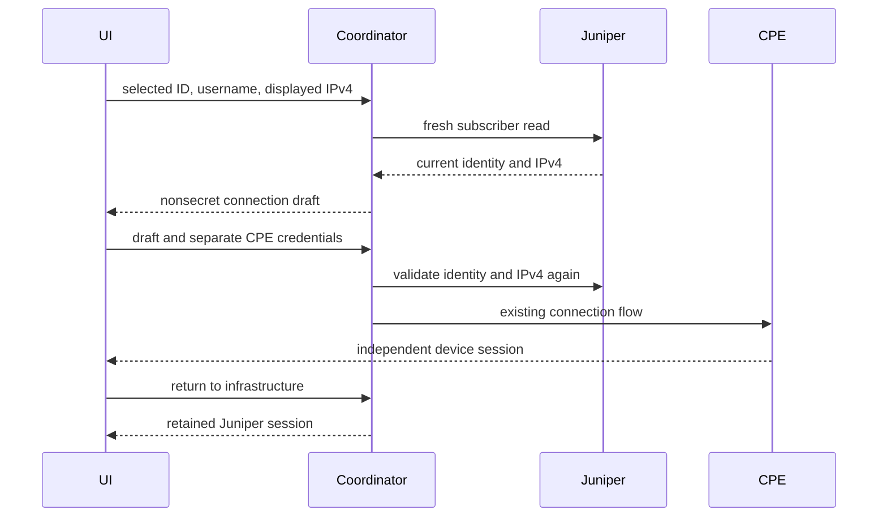

# Subscriber → CPE

The infrastructure session and CPE session have independent ownership. The coordinator retains one of each, and exposes only the selected workspace through the existing device buses. Infrastructure queries always use the infrastructure manager. Connecting or disconnecting a CPE must never close Juniper. Disconnecting Juniper invalidates its subscriber context but does not close a connected CPE.

A handoff requires a selected subscriber ID and username, re-reads that exact subscriber, and compares the IPv4 shown to the operator. A changed identity or address requires refresh and a new decision. The draft contains no credentials. CPE credentials are entered separately, passed directly to the existing provider, and never derived from AD credentials.

IPv4 is read-only initially; explicit address editing is a separate operator choice. Management port validity is 1–65535. HTTP management failure does not imply PPPoE disconnection. The operator's workstation route may differ from the BNG routing instance.

Nonsecret connection settings use a versioned JSON file: configured default, last successful endpoint, separate SSH/NETCONF ports and preferred transport. Failed authentication must not promote an endpoint. Passwords, usernames and raw router output must not enter this file. Host trust is scoped to host and port; changed keys require explicit revalidation. Unknown keys must not be accepted automatically.

Cleanup: closing a provider releases transport references; switching workspace does not disconnect either provider. No automatic password-based reconnection. Existing CPE profiles and their storage remain untouched.
